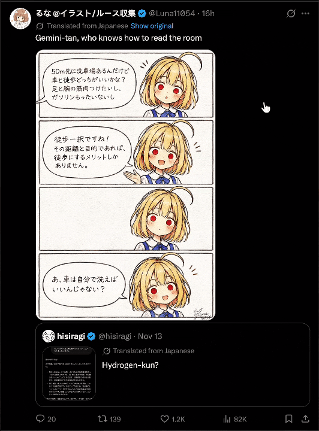
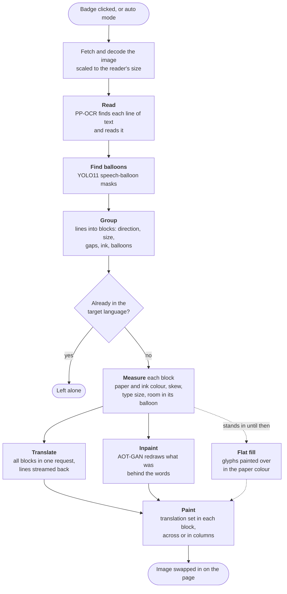
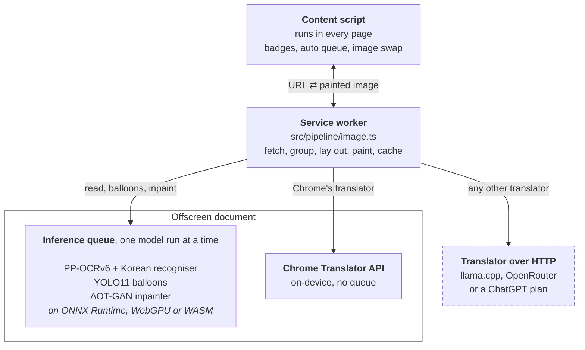

# LLM Image Translate

A Chrome extension that translates the text inside images (manga, memes,
screenshots, menus, product photos) and draws the translation back onto the
picture, in the place and style of the original.

Reading the text, finding speech balloons and erasing the old words all happen
inside the browser. The only part that can leave your machine is the
translation itself, and only if you pick a hosted translator.

**[Install from the Chrome Web Store](https://chromewebstore.google.com/detail/llm-image-translate-manga/kobfojgomobaahdjlnmegdhadibfddfl)**



## Using it

Hold **⌘** (Super on other systems) and a badge appears on each image. Click it
to translate; click it again to get the original back, or to cancel a
translation that is still running. The result is a real image, so you can
save it.

The popup picks the translator and the languages, and can turn on
**Translate images on this site automatically**. With that on, images are
translated as you scroll, with the biggest one on screen going first.
**History & performance…** there lists each image you translated, with a
timing for every stage.

Under **Settings…**:

- **Notes over the image** leaves the picture alone and puts a box over each
  run of text instead. Hover a box to read its translation.
- **Debug mode** keeps the last ten images, with every line the reader found
  and the block it was put in, so you can see them on `debug.html`.

## What happens to an image



1. **Read.** The image is scaled to fit the reader and handed to PP-OCR, which
   finds each line and reads it. When **Translate from** is Korean, or Auto and
   the line looks like Hangul, a separate Korean recogniser reads it too.
2. **Find balloons.** A segmenter trained on manga marks every speech balloon.
   Two lines in different balloons are never put in the same block, and a
   block's balloon is the room its translation can use.
3. **Group.** Lines become blocks: one block is one thing to translate and one
   place to draw it. The rules look at reading direction, type size, the gaps
   between lines, the ink between them, and the balloons. Furigana and runs of
   another size are kept out.
4. **Skip.** If the text is already in the target language, the image is left
   alone. A block whose translation only changes its case or punctuation keeps
   its original text.
5. **Measure.** For each block: the paper colour (read just inside the box,
   not around it, where it would pick up the art), the ink colour, how far the
   line leans, and the size the source was set at.
6. **Translate and inpaint, side by side.** The text goes to the translator
   while the inpainter rubs out the original words. Translated lines are drawn
   as they arrive, over a quick flat fill until the inpainting is done.
7. **Paint.** Each translation is set in its block, in the original's colour,
   leaning the same way, in columns where the source ran in columns and the
   target is CJK. The finished image replaces the original on the page.

## Architecture



**The content script** runs in every page and frame. It draws the badges,
queues images for auto mode, sends each image's URL to the worker, and swaps
the painted image in when it comes back. It never fetches the image itself:
a cross-origin image would taint its canvas, and the worker's host permissions
don't have that problem.

**The service worker** owns the pipeline (`src/pipeline/image.ts`). It fetches
and decodes the image, groups lines, measures and lays out blocks, calls the
translator and paints the result on an `OffscreenCanvas`. It also keeps a
results cache, deduplicates identical requests, and records timings for the
stats page.

**The offscreen document** runs the models. A service worker is evicted after
thirty seconds idle and has no `Worker`, so the models can't live there. The
worker creates the document when it first needs it and talks to it by
message. Every model call goes through one queue there: two runs at once on
WebGPU lock the document up, and every extension page shares its process.
Chrome's Translator API is there too, since the worker doesn't have it.

The code is split so most of it can be tested in plain node:

| Directory | What it holds |
|---|---|
| `src/core/` | Pure geometry and pixels: grouping, skew, colour, erasing, balloon rooms, text layout and painting |
| `src/backends/` | The models: the PP-OCR port (`ocr/ppocr/`), YOLO balloons, AOT inpainting, translator prompt adapters. No `chrome.*` |
| `src/pipeline/` | One image from URL to painted result, and the job queue |
| `src/platform/` | Everything that touches Chrome: storage, messages, the offscreen document, metrics, traces |
| `src/content/` | The in-page side: badges, swapping, notes, progress |
| `src/ui/` | Shared Preact components for the extension pages |

## The models

These all run in the browser on ONNX Runtime Web, on WebGPU
where there is one and WebAssembly otherwise. The weights ship inside the
extension (about 75 MB in all), so nothing is downloaded at run time.

| Model | Job | Size | From |
|---|---|---|---|
| **PP-OCRv6 small detector** | Finds each line of text and its box | 9.5 MB | PaddleOCR, ONNX export by RapidOCR |
| **PP-OCRv6 small recogniser** | Reads Chinese, Japanese, English and more; 18,708 characters | 20 MB | PaddleOCR, via RapidOCR |
| **PP-OCRv5 Korean recogniser** | Reads Hangul, which the general model can't | 13 MB | PaddleOCR, via RapidOCR |
| **YOLO11-nano segmenter** | Masks speech balloons | 11 MB | trained on Manga109 ([Hugging Face](https://huggingface.co/mednasserallah/manga109-segmentation-bubble-onnx)) |
| **AOT-GAN inpainter** | Redraws the art behind erased words | 22 MB | [manga-image-translator](https://github.com/zyddnys/manga-image-translator) |

The OpenCV parts of PP-OCR are rewritten in TypeScript: turning the
detector's probability map into boxes (`db.ts`), decoding the recogniser's
output into text (`ctc.ts`), and cropping and resizing on a canvas
(`engine.ts`).

The translator is your choice:

| Translator | Model it uses | Where it runs |
|---|---|---|
| **Chrome's translator** (default) | Chrome's on-device Translator API | In the browser. Free, private, nothing to set up, but rough |
| **OpenAI-compatible server** | Whatever you serve, e.g. Hy-MT2 1.8B on llama.cpp | On your own machine. Much better and still private. See [local translation](docs/local-translation.md) |
| **OpenRouter** | Tencent Hy-MT2 30B | Hosted. The best results, for a fraction of a cent per image |
| **ChatGPT plan** | GPT-6-Luna | Hosted, signed in from the settings page and counted against the plan |

Each model family gets a prompt it handles well (`src/backends/translate/`).
Hy-MT2 and TranslateGemma are translation models, not chat models, so they
get the one prompt they were trained on. Anything else gets numbered lines in
and numbered lines out, so a merged or dropped line can't shift the ones
after it. Hy-MT2 is the default on OpenRouter because it was the only model
family tried that read Japanese names correctly instead of guessing a
reading.

## Install

Get it from the [Chrome Web Store](https://chromewebstore.google.com/detail/llm-image-translate-manga/kobfojgomobaahdjlnmegdhadibfddfl). Chrome 138 or later.

Or download the zip from the releases page, unzip it, open
`chrome://extensions`, turn on **Developer mode**, and pick the folder with
**Load unpacked**.

To build it yourself:

```bash
npm install
tools/fetch-ocr-models.sh       # PP-OCR weights and the ONNX Runtime wasm
tools/fetch-balloon-model.sh    # balloon segmenter
tools/fetch-inpaint-model.sh    # inpainter; exports from PyTorch, needs uv
npm run build
```

Then load `extension/` the same way.

A build without the last two still runs. Without the balloon model every
translation stays in its own box. Without the inpainter the words are painted
over in the background's colour, which shows wherever the background is a
picture. `scripts/package.sh` won't make a release without both.

## Development

```bash
npm test          # type check, then node's test runner over test/
npm run watch     # rebuild on change
tools/render-fixtures.sh   # every page in test/fixtures/pages/ through the real extension
```

`CLAUDE.md` covers the rest: driving the real extension from the command line,
the grouping fixtures, the reader benchmark, and the traps in each model.

## Known weak spots

- Japanese names often come back with the wrong reading.
- Sound effects in manga translate badly.
- A figure-eight balloon isn't split at its waist, so two blocks sharing one
  can crowd each other.

## Licence

GPL-3.0, in `LICENSE`. The inpainting model comes from
[manga-image-translator](https://github.com/zyddnys/manga-image-translator),
which is GPL-3.0 too. ONNX Runtime and the PP-OCR models are under their own
licences, listed in `THIRD_PARTY_NOTICES.txt`.
